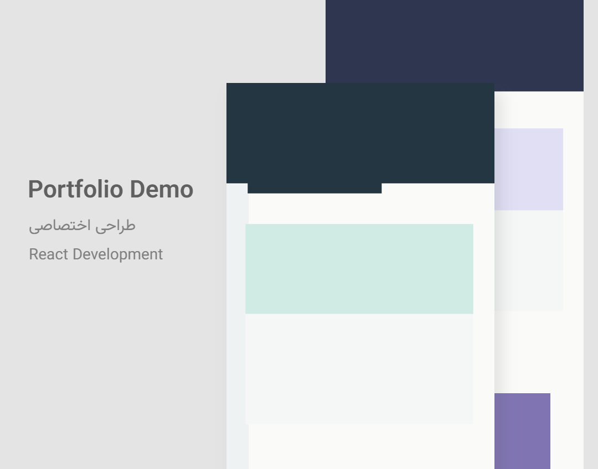

# ابزار ساخت کاور نمونه‌کار

از اسکرین‌شات وب‌سایت و اطلاعات پروژه، تصویر معرفی نمونه‌کار بسازید. برنامه شش قالب قابل‌ویرایش دارد و خروجی PNG یا WebP را با Canvas در مرورگر تولید می‌کند.

در حالت پیش‌فرض به حساب کاربری، API خصوصی، کلید دسترسی یا پایگاه داده نیاز نیست. پروژه‌ها و تصویرهای بارگذاری‌شده در IndexedDB همین مرورگر ذخیره می‌شوند. PHP و MySQL فقط برای حالت اختیاری توسعهٔ محلی لازم‌اند.

مستندات انگلیسی: [README.md](README.md).

## قابلیت‌ها

- شش چیدمان کاور برای نمونه‌کار وب، شبکه‌های اجتماعی، کلاژ، نمایش دستگاه‌ها و لپ‌تاپ.
- بارگذاری تصویرهای محلی PNG، JPEG و WebP؛ فایل SVG پذیرفته نمی‌شود.
- ویرایش اطلاعات پروژه، لوگو، فناوری‌ها، جایگاه تصویر، برش، سایه و پرسپکتیو.
- پیش‌نمایش زنده و خروجی PNG یا WebP با مقیاس ۱×، ۲× یا ۳×.
- ذخیره‌سازی محلی در مرورگر و پشتیبان ZIP برای انتقال پروژه.

## نمونهٔ خروجی

این تصویر از اسکرین‌شات‌های ساختگی مخزن تولید شده و هیچ اطلاعات واقعی سایت یا مشتری در آن نیست.



## پیش‌نیازها

- Node.js نسخهٔ 22.12 یا جدیدتر، شاخهٔ 24، یا شاخهٔ 26.
- npm نسخهٔ 10 یا جدیدتر.
- مرورگر مدرن با پشتیبانی از Canvas، IndexedDB و `createImageBitmap`.

PHP CLI با افزونهٔ `pdo_mysql` و MySQL محلی فقط برای حالت اختیاری SQL نیاز است.

## نصب و اجرا

```sh
git clone <repository-url>
cd <cloned-repository-directory>
npm ci
npm run dev
```

نشانی محلی‌ای را که Vite در ترمینال نشان می‌دهد باز کنید. سرور توسعه فقط روی `127.0.0.1` گوش می‌دهد.

برای ساخت و پیش‌نمایش نسخهٔ تولید:

```sh
npm run build
npm run preview
```

نسخهٔ ساخته‌شده به‌صورت پیش‌فرض یک برنامهٔ ایستا است. قواعد Apache موجود، API اختیاری را در استقرار عمومی مسدود می‌کند.

## استفاده

1. پروژه بسازید و یکی از قالب‌ها را انتخاب کنید.
2. تصویرهای جلو، عقب و در صورت نیاز موبایل را بارگذاری کنید.
3. اطلاعات پروژه را وارد کنید. افزودن لوگو یا امضا اختیاری است و به‌صورت پیش‌فرض هیچ لوگویی در خروجی قرار نمی‌گیرد.
4. چیدمان را در پیش‌نمایش تنظیم و قالب و اندازهٔ خروجی را انتخاب کنید.
5. خروجی را دانلود کنید. با پشتیبان ZIP می‌توانید پروژه را به مرورگر یا دستگاه دیگری انتقال دهید.

## حالت اختیاری MySQL محلی

دستور معمول `npm run dev` PHP را اجرا نمی‌کند و به MySQL وصل نمی‌شود. برای ذخیره‌سازی در MySQL محلی:

1. PHP CLI را با افزونهٔ `pdo_mysql` و یک سرور MySQL محلی نصب کنید.
2. `api/config.local.php.example` را به `api/config.local.php` کپی کنید و تنظیمات محلی را وارد کنید. فایل پیکربندی محلی در Git نادیده گرفته می‌شود.
3. دستور `npm run dev:sql` را اجرا کنید.

API PHP فقط روی `127.0.0.1:8787` گوش می‌دهد و درخواست‌های غیرمحلی یا دارای مبدأ مرورگر غیرمحلی را رد می‌کند. در این حالت، اطلاعات پروژه و بایت‌های تصویر فقط به سرویس MySQL محلی شما فرستاده می‌شوند. API را از طریق reverse proxy عمومی در دسترس قرار ندهید.

متغیرهای `PORTFOLIO_DB_HOST`، `PORTFOLIO_DB_PORT`، `PORTFOLIO_DB_NAME`، `PORTFOLIO_DB_USER` و `PORTFOLIO_DB_PASSWORD` برای تنظیم PHP در دسترس‌اند. هیچ رمز یا کلید خصوصی را در متغیرهای `VITE_*` قرار ندهید. حساب MySQL باید اجازهٔ ساخت پایگاه داده و جدول‌ها را داشته باشد.

## حریم خصوصی و نگهداری داده

در حالت پیش‌فرض، تصویرها، اطلاعات پروژه، پیش‌نمایش و خروجی در دستگاه و مرورگر شما می‌مانند. برنامه نشانی سایت را واکشی نمی‌کند و داده‌ها را به سرویس بیرونی نمی‌فرستد. تحلیل‌گر، telemetry یا سامانهٔ گزارش خطا در برنامه تنظیم نشده است. فایل‌های فونت از بسته‌های npm همراه برنامه ارائه می‌شوند و از CDN بارگیری نمی‌شوند.

حالت MySQL اختیاری است و فقط باید به سرویس محلی خودتان وصل شود. داده‌های IndexedDB به پروفایل همان مرورگر وابسته‌اند؛ برای انتقال یا پشتیبان‌گیری از ZIP استفاده کنید.

## ساخت و بررسی کد

```sh
npm run lint
npm run typecheck
npm test
npm run build
```

تصویرهای ساختگی برای آزمایش در `public/test-fixtures/` قرار دارند. برای ساخت دوبارهٔ آن‌ها اجرا کنید:

```sh
node scripts/create-test-fixtures.mjs
```

## محدودیت‌ها

- رابط کاربری فعلی فارسی و راست‌به‌چپ است؛ فیلدهای متن، فارسی و لاتین را پشتیبانی می‌کنند.
- حجم هر تصویر حداکثر ۴۰ مگابایت، طول هر ضلع حداکثر ۳۲٬۷۶۸ پیکسل و تعداد پیکسل هر تصویر حداکثر ۳۵ میلیون است.
- SVG بارگذاری نمی‌شود. اسکرین‌شات سایت را جداگانه تهیه و به‌صورت تصویر بارگذاری کنید.
- backend عمومی و چندکاربره ارائه نشده است؛ حالت PHP/MySQL فقط برای توسعهٔ محلی است.
- متن‌های خیلی بلند ممکن است به دو خط بشکنند و به جابه‌جایی دستی نیاز داشته باشند؛ برنامه هم‌پوشانی یا سرریز متن را هشدار می‌دهد.

## راهنمای معماری

تصمیم‌های فنی، مشخصات قالب‌ها و روش افزودن قالب در [راهنمای معماری و قالب‌ها](./داکیومنت/راهنمای-معماری-و-قالب‌ها.md) آمده‌اند.

## اعتبار سازنده و مجوز

مستندات قبلی Webzad را به‌عنوان سازنده معرفی می‌کنند؛ این اعتبار فقط در همین بخش نگه داشته شده و پیش‌فرض برنامه یا واترمارک خروجی نیست: [وب‌سایت سازنده](https://webzad.ir).

در حال حاضر فایل `LICENSE` وجود ندارد. عمومی‌بودن مخزن به‌تنهایی اجازهٔ بازاستفاده یا بازتوزیع نمی‌دهد. دارندهٔ حق نشر باید پیش از معرفی پروژه به‌عنوان متن‌باز، مجوز مناسب را انتخاب و اضافه کند.

گزارش مشکل را در issue tracker مخزن و گزارش آسیب‌پذیری را از مسیر خصوصیِ تأییدشدهٔ مالک ارسال کنید؛ هنوز نشانی عمومی مخزن یا مسیر خصوصی گزارش در فایل‌های پروژه مشخص نشده است.
