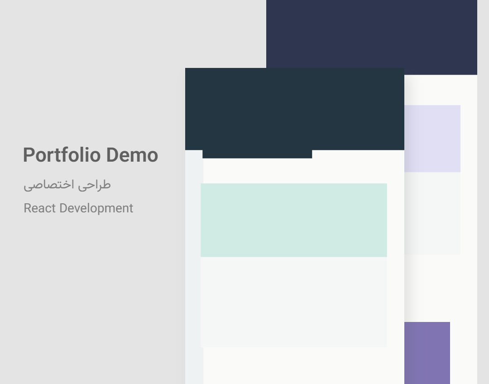

# Portfolio Cover Generator

Create polished portfolio cover images from website screenshots and project details. The app renders PNG or WebP images in the browser with Canvas and includes layouts for web portfolios, social posts, editorial collages, device showcases, and floating laptop screens.

The default setup is a client-side app. It needs no account, private service, API key, or database: projects and uploaded images stay in this browser's IndexedDB, and exports are generated on this device. An optional PHP/MySQL mode is available for local development only.

Persian documentation: [README.fa.md](README.fa.md).

## Example

This sample cover was generated by the app from synthetic screenshots. It contains no real site or customer data.



Synthetic input fixtures are available in [`public/test-fixtures`](public/test-fixtures/).

## Features

- Six editable cover layouts with live preview.
- Local PNG, JPEG, and WebP screenshot uploads; SVG uploads are rejected.
- Editable project text, logo, technology icons, layer positions, cropping, shadows, and perspective.
- PNG or WebP export at 1×, 2×, or 3×.
- Local browser storage and ZIP project backup/import.
- Optional loopback-only PHP/MySQL persistence for local development.

## Requirements

- Node.js 22.12 or newer, 24.x, or 26.x.
- npm 10 or newer.
- A modern browser with Canvas, IndexedDB, and `createImageBitmap` support.

PHP CLI with `pdo_mysql` and a local MySQL server are only needed for the optional SQL mode.

## Install and run

```sh
git clone <repository-url>
cd <cloned-repository-directory>
npm ci
npm run dev
```

Open the local address printed by Vite. The development server binds to `127.0.0.1`.

To build and preview a production bundle:

```sh
npm run build
npm run preview
```

The built app is static and uses browser storage by default. The repository's Apache rules deny the optional API on public Apache deployments.

## Use the editor

1. Create a project and choose a layout.
2. Upload the screenshots for its front, back, and, where applicable, mobile layers.
3. Edit the project details and choose whether to upload a logo or add a signature. Neither is required.
4. Adjust the image layers and output format/scale in the preview.
5. Download the rendered image. Use the ZIP backup controls to move a project to another browser or device.

The interface is currently Persian and right-to-left. Project text fields support Persian and Latin text, including automatic text direction.

## Optional local MySQL mode

The default `npm run dev` does not start PHP or connect to MySQL. To use the optional local SQL persistence mode:

1. Install PHP CLI with `pdo_mysql` and a local MySQL server.
2. Copy `api/config.local.php.example` to `api/config.local.php` and set local database credentials. The local file is ignored by Git.
3. Run `npm run dev:sql`.

The PHP API binds to `127.0.0.1:8787`; requests from non-loopback clients and non-local browser origins are rejected. The app sends project records and image bytes only to that local API when this mode is enabled. Do not expose the API through a public reverse proxy. `PORTFOLIO_DB_HOST`, `PORTFOLIO_DB_PORT`, `PORTFOLIO_DB_NAME`, `PORTFOLIO_DB_USER`, and `PORTFOLIO_DB_PASSWORD` can also configure the PHP process. No database credentials belong in `VITE_*` variables.

The first run creates the configured database and tables, so the MySQL account needs permission to create them. Existing local configurations and databases are not modified by this repository preparation.

## Privacy and storage

In the default mode, uploads, project information, browser storage, preview images, and generated exports remain on the device. The app does not fetch a website URL or send image data to an external service. There is no analytics or error-reporting integration. The optional SQL mode sends app data only to the user's local PHP/MySQL service at loopback.

Installed npm packages are used to build and run the app. Font files are bundled from npm packages rather than fetched from a font CDN.

## Validation and tests

```sh
npm run lint
npm run typecheck
npm test
npm run build
```

Recreate the synthetic screenshot fixtures with:

```sh
node scripts/create-test-fixtures.mjs
```

## Known limits

- The current interface is Persian-only.
- Each uploaded image is limited to 40 MiB, 32,768 pixels per side, and 35 million pixels.
- Very long text can wrap into two lines and may need manual repositioning; the editor warns about text overlap and overflow.
- SVG input is not supported. Remote website screenshots must be captured separately and uploaded as image files.
- Browser storage is local to the browser profile. Use ZIP backup to move projects or keep a separate copy.
- MySQL mode is intended for local development; the repository does not provide a public, authenticated multi-user backend.

## Contributing and support

Use the issue tracker and pull request flow associated with the repository once its final public URL is set. No repository URL or private vulnerability-reporting route is currently configured in the project files.

## Creator credit and license

The existing project documentation credits Webzad as the creator; that attribution is retained here only as creator credit, not as an app default or export mark: [webzad.ir](https://webzad.ir).

This repository does not currently include a `LICENSE` file. Public visibility alone does not grant reuse or redistribution rights. The copyright holder must choose and add a license before calling this an open-source release.
